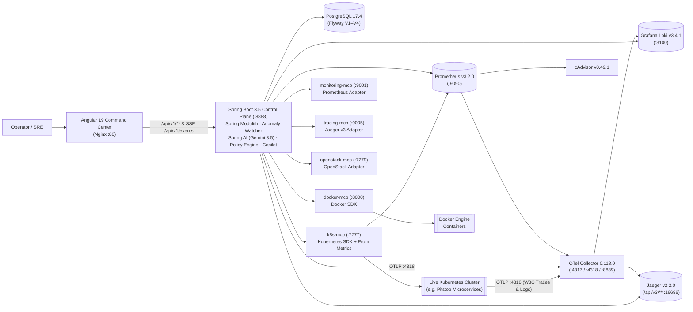

# HealOps — Autonomous AIOps & Incident Autopilot Platform

> **Autonomous fault detection, multi-signal observability correlation, grounded AI root-cause diagnosis, human-in-the-loop remediation, and closed-loop health verification** powered by a Spring Boot 3.5 + Spring Modulith control plane, Spring AI (Google Gemini 3.5 Flash-Lite), an Angular 19 operational command center, PostgreSQL 17, OpenTelemetry (Prometheus, Grafana Loki, Jaeger v3, cAdvisor), and FastAPI Model Context Protocol (MCP) infrastructure adapters for Kubernetes, Docker, and OpenStack.

HealOps closes the loop between **live observability** and **safe infrastructure remediation**. Continuously monitoring real Kubernetes workloads and container metrics in the background—as well as ingesting Prometheus Alertmanager webhooks and natural-language operator requests through the Operations Copilot—HealOps automatically detects runtime anomalies, collects correlated multi-signal evidence (Kubernetes pod/deployment state & events, live Prometheus CPU/memory utilization, Grafana Loki application logs, and Jaeger v3 distributed traces), synthesizes evidence-cited root-cause diagnoses with **Gemini 3.5 Flash-Lite**, queues policy-gated allowlisted remediation actions for operator approval, executes them through non-shell SDK adapters, and verifies `BEFORE` vs. `AFTER` recovery with automatic rollback protection.

---

## Key Platform Capabilities

### 1. Continuous Autonomous Anomaly Detection & Alert Intake
- **Autonomous Infrastructure Watcher (`InfrastructureAnomalyWatcher`):** Continuously polls live Kubernetes namespaces (configurable via `healops.watcher.k8s-namespaces`, default `pitstop,default`) and Prometheus/cAdvisor resource telemetry on a scheduled loop. Automatically detects and opens deduplicated incidents (`source: k8s-anomaly-watcher`) with zero manual intervention when real workloads exhibit:
  - Container image rollout faults (`ImagePullBackOff`, `ErrImagePull`, `InvalidImageName`)
  - Container runtime crashes (`CrashLoopBackOff`, `OOMKilled`, `CreateContainerConfigError`)
  - Unhealthy pod phases (`Failed`) or elevated restart loops (`restarts >= 3`)
  - Live resource saturation (`cpu_percent >= 85%` or `memory_percent >= 85%`)
- **Webhook & API Intake:** Ingests external alerts via Prometheus Alertmanager webhooks (`POST /api/v1/incidents/webhooks/alertmanager`) and `POST /api/v1/incidents` with idempotent deduplication (`source + environmentId + fingerprint`) and `@Version` optimistic locking.
- **Durable Event-Driven State Machine:** Orchestrates every incident through an auditable 6-stage lifecycle persisted via Spring Modulith JPA event publications with automatic startup recovery:
  `ALERTED` $\rightarrow$ `GATHERING_EVIDENCE` $\rightarrow$ `CORRELATING_SIGNALS` $\rightarrow$ `DIAGNOSING` $\rightarrow$ `AWAITING_APPROVAL` $\rightarrow$ `EXECUTING` $\rightarrow$ `VERIFYING` $\rightarrow$ `CLOSED` (or `ROLLING_BACK` $\rightarrow$ `ROLLED_BACK` / `FAILED`).

### 2. Real-Time Multi-Signal Evidence Collection & Correlation
Every incident automatically gathers bounded, secret-redacted, SHA-256-hashed evidence across all active telemetry pillars:
- **Kubernetes Runtime Intelligence (`k8s-mcp` & `KubernetesEvidenceCollector`):**
  - Inspects live pod phases, container readiness ratios (`1/1`, `0/1`), restart counts, termination state, waiting/terminated container reasons, and pod UIDs.
  - Inspects owned `ReplicaSet` revision history on Kubernetes `Deployment`s to resolve `revision`, `previous_revision`, `updatedReplicas`, and `rollback_available`.
  - Collects active pod `Warning` events and bounded container log tails while filtering out stale events from healthy or terminated pods.
- **Live Prometheus & cAdvisor Metrics (`PrometheusEvidenceCollector`, `MetricsQueryService`, `k8s-mcp`):**
  - Resolves real per-pod and per-container CPU `%`, working-set Memory `MB`, and Memory `%` directly from Prometheus/cAdvisor (including cgroup v2 pod-UID and container-ID matching).
  - Automatically attaches `METRIC` (`source=prometheus`) evidence to incidents and powers live Chart.js metric time-series graphs in `/services`.
- **Grafana Loki Application Logs (`LokiEvidenceCollector` & `LogsQueryService`):**
  - Queries live OTLP-ingested Loki streams scoped by `deployment_environment`, `service_name`, and `trace_id`, prioritizing `ERROR` and `WARN` lines with automatic credential redaction.
- **Jaeger v3 Distributed Traces & Derived Service Topology (`JaegerTraceEvidenceCollector`, `TracesQueryService`, `TopologyDerivationService`):**
  - Queries Jaeger v3 OTLP traces (`/api/v3/traces`) to compute end-to-end latency, critical-path spans, slowest operations, and failing downstream dependency calls.
  - Automatically derives live service dependency graphs (nodes, directed call edges, call volumes, error rates, and average latencies) rendered interactively in Cytoscape on `/services`.
- **Docker & OpenStack Telemetry (`docker-mcp`, `openstack-mcp`, `monitoring-mcp`):**
  - Inspects Docker container lifecycle/health states enriched with live Prometheus CPU/memory utilization and supports OpenStack compute service event/status collection.

### 3. Grounded Hybrid AI + Deterministic Root-Cause Diagnosis
- **Deterministic Diagnostics Engine (`DeterministicDiagnosticsEngine`):** Evaluates repeatable SRE diagnostic rules (`IMAGE_PULL_BACKOFF`, `CRASH_LOOP_BACKOFF`, `OOM_KILLED`, `PROBE_FAILURE`, `HIGH_ERROR_RATE`, `HIGH_LATENCY`, `CPU_SATURATION`, `MEMORY_SATURATION`, `WORKLOAD_UNHEALTHY`) to produce a verified baseline finding set and structured health snapshot.
- **Grounded Gemini 3.5 Synthesis (`LlmDiagnosisService` & `DiagnosisValidationService`):** Sends bounded, redacted multi-signal evidence (Kubernetes events, Prometheus metrics, Loki logs, and Jaeger v3 trace summaries) to **Google Gemini 3.5 Flash-Lite** (`gemini-3.5-flash-lite@diagnosis-prompt-v2`). Every generated hypothesis is strictly validated before persistence to guarantee it cites real persisted `evidence_items` UUIDs and recommends only a schema-valid allowlisted action.

### 4. Interactive Operations Copilot (`/chat`) with Live Telemetry & Multi-Command Queuing
- **Real-Time Multi-Pillar Awareness (`CopilotToolQueryService`):** Automatically hydrates live Kubernetes pod status with Prometheus CPU/memory usage, live Grafana Loki application logs, live Jaeger v3 distributed traces, live Docker container states, environment health overviews, and recent incident context into each conversation turn.
- **Natural-Language Action Planning & Approval Queuing (`CopilotActionProposalService`):** Operators can inspect live health/errors/logs/traces in plain English or request single and multi-step operational changes (e.g., *"scale gateway to 2 replicas"* or *"scale gateway to 2 replicas and restart customer"*). Copilot validates each command through `ActionCatalogValidator`, opens tracked `AWAITING_APPROVAL` workflows with `BEFORE` health snapshots, and queues them straight into `/approvals` with one-click review links.

### 5. Policy-Gated Execution, Closed-Loop Verification & Automatic Rollback
- **Typed Allowlisted Action Catalog (`ActionCatalogValidator`):**
  - `ROLLBACK_K8S_DEPLOYMENT` (`namespace`, `deployment`, `revision`) — reversible (`ROLLOUT_TO_PRIOR_REVISION`)
  - `SCALE_K8S_DEPLOYMENT` (`namespace`, `deployment`, `replicas` `1..10`) — reversible (`RESTORE_PREVIOUS_REPLICAS`)
  - `RESTART_K8S_WORKLOAD` (`namespace`, `workload`, `kind`: `Deployment` | `StatefulSet` | `DaemonSet`)
  - `RESTART_CONTAINER` (`container`)
  - `RESTART_OPENSTACK_SERVICE` (`node`, `service`)
- **Governance & Idempotency (`ApprovalService` & `PolicyEvaluator`):** Enforces environment-scoped RBAC (`env:<id>`, `incident:approve`), protected Kubernetes namespace guards (`kube-system`, `kube-public`, `kube-node-lease`), `Idempotency-Key` replay safety, and `@Version` optimistic concurrency (`409 Conflict`).
- **Rollout Convergence & Post-Action Verification (`HealthVerificationComparator`):** Polls runtime adapters during `VERIFYING` as Kubernetes rollouts and readiness/startup probes converge, compares `BEFORE` and `AFTER` health snapshots, automatically triggers rollback (`ROLLING_BACK` $\rightarrow$ `ROLLED_BACK`) if post-remediation verification degrades on a reversible action, and generates a complete Markdown + structured JSON post-incident report.

### 6. Angular 19 Operational Command Center (`agentUI`)
- **6-Stage Visual Autopilot Stepper:** Tracks real-time incident progression across `Alert Ingested`, `Evidence Collected`, `AI Diagnosis`, `Operator Approval`, `Execute & Verify`, and `Final Outcome` via Server-Sent Events (`/api/v1/events`).
- **Structured Telemetry & Kubernetes Evidence Drawer:** Renders pod tables with live CPU/memory metrics, deployment revision badges, warning event cards, correlated logs/traces, and formatted evidence payloads.
- **In-Place & Queue-Based Approvals:** Review command previews and approve or reject actions directly inside `/incidents/:id`, in `/approvals`, or from Copilot chat (`/chat`).
- **Unified Observability & Runbook Catalog:** Interactive Cytoscape service dependency map, Chart.js live Prometheus metric charts, correlated Loki log and Jaeger v3 trace explorer (`/services`), and versioned runbook drafting/publishing (`/runbooks`).

---

## System Architecture



---

## Technology Stack

| Layer | Technologies & Versions |
| :--- | :--- |
| **Control Plane & AI Orchestration** | Java `21`, Spring Boot `3.5.6`, Spring Modulith `1.4.1`, Spring Security `6.5` (RBAC + CSRF cookies), Spring AI `1.0.3` (Google Gemini `gemini-3.5-flash-lite`), Springdoc OpenAPI `2.8.8` |
| **Frontend Command Center** | Angular `19.2` (Standalone `OnPush` Signals), RxJS `7.8`, TypeScript `5.7`, Bootstrap `5.3.8` (Selective SCSS), Bootstrap Icons `1.13.1`, Chart.js `4.4.8`, Cytoscape `3.30.4`, Marked `16.4.0`, Nginx `1.27.4-alpine` |
| **Database & Migrations** | PostgreSQL `17.4-alpine`, Flyway (`V1`–`V4` schema migrations, `ddl-auto=validate`) |
| **Observability Pipeline** | OpenTelemetry Collector Contrib `0.118.0`, Jaeger `2.2.0` (OTLP + `/api/v3/**`), Grafana Loki `3.4.1`, Prometheus `3.2.0`, cAdvisor `v0.49.1` |
| **MCP Infrastructure Adapters** | Python `3.11` / `3.13`, FastAPI `0.115.12`, Uvicorn `0.34.0`, Official Kubernetes Python Client `34.1.0`, Docker SDK `7.1.0` |
| **Testing & Quality Assurance** | JUnit 5, Spring `@WebMvcTest`, PostgreSQL Testcontainers, Karma + ChromeHeadless, `pytest`, Static Security & Anti-Pattern Verifier |

---

## Repository Structure

```text
HealOps/
├── Openstack-ai-agent/          # Java 21 / Spring Boot 3.5 control plane & orchestration engine
│   └── src/main/java/com/example/Openstack_ai_agent/
│       ├── analytics/           # MTTR, approval latency & per-action success rate calculator
│       ├── audit/               # Immutable append-only audit trail
│       ├── conversation/        # Operations Copilot, live telemetry tools & multi-action queuing
│       ├── diagnosis/           # Deterministic rules, Gemini 3.5 synthesis & BEFORE/AFTER verifier
│       ├── environment/         # Environment registry & capability scoping (local, staging)
│       ├── evidence/            # Autonomous watcher + K8s, Prometheus, Loki, Jaeger, Docker & OpenStack collectors
│       ├── incident/            # Guarded state machine, deduplication & Spring Modulith workflow events
│       ├── observability/       # SSE event stream, Prometheus/Loki/Jaeger BFF & derived service topology
│       ├── remediation/         # Allowlisted action catalog, policy evaluator, approvals & SDK executors
│       └── runbook/             # Versioned runbook drafting, matching & publishing
├── agentUI/                     # Angular 19 operational dashboard & Nginx SSE reverse proxy
├── mcp_k8s_server/              # FastAPI Kubernetes MCP adapter with live Prometheus pod metric enrichment
├── mcp_docker_server/           # FastAPI Docker MCP adapter (container inspection, stats, logs, restart)
├── mcp-server-promethus/        # FastAPI Prometheus monitoring & time-series forecasting MCP adapter
├── tracing_mcp/                 # FastAPI Jaeger v3 distributed trace analysis MCP adapter
├── mcp_openstack_server/        # FastAPI OpenStack service & log analysis MCP adapter
├── observability/               # OpenTelemetry Collector pipeline configuration (traces, logs, metrics)
└── scripts/                     # Automated security verifier & end-to-end live acceptance suite
```

---

## Getting Started

### Prerequisites
- **Docker Desktop** (or Docker Engine + Docker Compose v2) with **Kubernetes enabled** for live cluster orchestration
- **Java 21**, **Node.js 20+**, and **Python 3.11+** (for running local test suites)
- A **Google Gemini API Key** (`GEMINI_API_KEY`) for AI root-cause diagnosis and interactive Operations Copilot

### 1. Configure Environment Variables

Copy `.env.example` to `.env`:

```powershell
# Windows PowerShell
Copy-Item .env.example .env
```

```bash
# Linux / macOS
cp .env.example .env
```

Configure your database password, Gemini API key, and operator credentials in `.env`:

```dotenv
GEMINI_API_KEY=your_gemini_api_key_here
GEMINI_MODEL=gemini-3.5-flash-lite
POSTGRES_DB=healops
POSTGRES_USER=healops
POSTGRES_PASSWORD=your_secure_postgres_password
HEALOPS_OPERATOR_USER=operator
HEALOPS_OPERATOR_PASSWORD=operator-local-dev
HEALOPS_VIEWER_USER=viewer
HEALOPS_VIEWER_PASSWORD=viewer-local-dev
```

Optional watcher settings (configured in `application.properties` or environment variables):
- `HEALOPS_WATCHER_ENABLED=true` — enables continuous autonomous Kubernetes + Prometheus fault detection
- `HEALOPS_WATCHER_K8S_NAMESPACES=pitstop,default` — comma-separated namespaces monitored by `InfrastructureAnomalyWatcher`
- `HEALOPS_WATCHER_INTERVAL_MS=20000` — background polling interval in milliseconds

### 2. Connect Your Kubernetes Cluster

Generate a container-reachable kubeconfig (`config-healops`) pointing `127.0.0.1` / `localhost` to `host.docker.internal` so `k8s-mcp` can communicate directly with your Kubernetes API server:

```powershell
# Windows PowerShell
$raw = kubectl config view --raw
$raw -replace 'https://127\.0\.0\.1:', 'https://host.docker.internal:' -replace 'https://localhost:', 'https://host.docker.internal:' |
  Set-Content "$env:USERPROFILE\.kube\config-healops"
```

### 3. Build and Start HealOps

```powershell
# Windows PowerShell
$env:CADVISOR_PORT = "18080"
$env:KUBECONFIG_PATH = "$env:USERPROFILE\.kube\config-healops"
docker compose --profile kubernetes up -d --build
```

```bash
# Linux / macOS
export CADVISOR_PORT=18080
export KUBECONFIG_PATH="$HOME/.kube/config-healops"
docker compose --profile kubernetes up -d --build
```

Open **[http://localhost](http://localhost)** and sign in with:
- **Operator Role (Full Read/Write/Approve/Publish):** `operator` / `operator-local-dev`
- **Viewer Role (Read-Only):** `viewer` / `viewer-local-dev`

### 4. Connect Application Telemetry (OTLP Logs & Traces)

Any microservice exporting OpenTelemetry OTLP/HTTP JSON or gRPC telemetry to the HealOps collector (`http://host.docker.internal:4318` from local Kubernetes pods, or `http://otel-collector:4318` on the Compose network) with resource attributes `service.name` and `deployment.environment=local` automatically populates:
- **Grafana Loki** application logs (`/api/v1/logs` and incident log evidence),
- **Jaeger v3** distributed traces (`/api/v1/traces` and incident trace evidence), and
- **Derived Service Topology** (`/api/v1/topology` in `/services`).

---

## Live Kubernetes Microservices Walkthrough (Pitstop Case Study)

HealOps is verified end-to-end against real OTLP-instrumented Kubernetes microservices from **[Pitstop](https://github.com/Mouad852/pitstop)** (`gateway`, `customer`, `mysql-customer`, `rabbitmq`) running in the `pitstop` namespace.

### Scenario 1 — Autonomous Broken Rollout Detection & Rollback (`ErrImagePull` / `ImagePullBackOff` $\rightarrow$ `ROLLBACK_K8S_DEPLOYMENT`)
1. **Deploy a bad image tag directly to Kubernetes (no manual alert trigger required):**
   ```powershell
   kubectl -n pitstop set image deployment/customer customer=pitstop-customer:broken-v999
   ```
2. **Autonomous Detection & Multi-Signal Investigation:**
   - Within seconds, **`InfrastructureAnomalyWatcher`** detects `ErrImagePull`/`ImagePullBackOff` on the new `customer` pod and automatically opens a deduplicated incident (`source: k8s-anomaly-watcher`) in `local`.
   - HealOps automatically collects live evidence across all 4 telemetry stacks with zero collection errors:
     - `KUBERNETES_EVENT` & `LOG` from `k8s-mcp` (failing pod state, active warning events, container logs, and `previous_revision` history)
     - `METRIC` from `prometheus` (live per-pod CPU `%` and working-set Memory `MB`/`%`)
     - `LOG` from `loki` (recent OTLP application `INFO`/`WARN`/`ERROR` logs)
     - `TRACE` from `jaeger` (distributed `gateway -> customer -> mysql-customer` spans)
   - **Gemini 3.5 Flash-Lite** (`gemini-3.5-flash-lite@diagnosis-prompt-v2`) synthesizes the root cause citing exact persisted evidence UUIDs and proposes **`ROLLBACK_K8S_DEPLOYMENT`** (`kubectl rollout undo deployment/customer -n pitstop --to-revision=<prior>`).
3. **Human-Approved Execution & Closed-Loop Verification:**
   - Approve the proposal on `/incidents/:id` or `/approvals`.
   - `k8s-mcp` executes the live Kubernetes rollout undo, HealOps waits for readiness probes to converge (`2/2 Running`), confirms `BEFORE=UNHEALTHY (ImagePullBackOff)` $\rightarrow$ `AFTER=HEALTHY (Running)`, closes the incident (`CLOSED`), and generates the full post-incident Markdown report.

### Scenario 2 — Live Service Observability & Topology (`/services`)
1. Send traffic through Pitstop's `gateway` $\rightarrow$ `customer` $\rightarrow$ `mysql-customer`.
2. Open **[http://localhost/services](http://localhost/services)** in `local` to explore:
   - **Derived Service Topology:** Real directed edges (`gateway -> customer -> mysql-customer`) with live call counts and average latencies.
   - **Live Prometheus Metrics:** Real per-pod CPU `%` and Memory time-series charts (`dataSource: PROMETHEUS`).
   - **Live Loki Logs & Jaeger v3 Traces:** Correlated `trace_id` log lines (`INFO`, `404 WARN`, `5xx ERROR`) linked directly to multi-service distributed traces.

### Scenario 3 — Live Telemetry Inspection & Multi-Command Queuing via Copilot (`/chat`)
1. Open **[http://localhost/chat](http://localhost/chat)** in `local`.
2. **Inspect live multi-pillar telemetry in natural language:**
   > *"Inspect recent errors, logs, traces, and metrics for customer and gateway and tell me if anything looks wrong"*
   - Copilot inspects live Kubernetes pods, Prometheus CPU/memory metrics, Loki logs, and Jaeger v3 traces, returning a structured breakdown of per-pod utilization, log error/warning counts (e.g., `404 Not Found` warnings vs. healthy `200 OK` traffic), and overall service health.
3. **Queue single or multi-step remediation plans into `/approvals`:**
   > *"Scale gateway to 2 replicas and restart customer"*
   - Copilot validates each command against the allowlisted action catalog, opens tracked `AWAITING_APPROVAL` workflows, and presents a **`Queued for Operator Approval (/approvals)`** table with direct review and approve links.

---

## Service Endpoints & Ports

| Service | Local URL | Purpose |
| :--- | :--- | :--- |
| **HealOps Web UI (Angular 19 + Nginx)** | [http://localhost](http://localhost) | Operational command center, `/api/**` reverse proxy & SSE stream |
| **Control Plane API & Actuator** | [http://localhost:8888/actuator/health](http://localhost:8888/actuator/health) | Spring Boot 3.5 REST API & Swagger UI (`/swagger-ui.html`) |
| **Kubernetes MCP Adapter** | [http://localhost:7777/docs](http://localhost:7777/docs) | Live Kubernetes pods (with Prometheus CPU/RAM), deployments, events, logs, scale, rollback & restart |
| **Docker MCP Adapter** | [http://localhost:8000/docs](http://localhost:8000/docs) | Live Docker container inspection, stats, logs & restart |
| **Monitoring MCP Adapter** | [http://localhost:9001/docs](http://localhost:9001/docs) | Prometheus metric queries & time-series analysis |
| **Tracing MCP Adapter** | [http://localhost:9005/docs](http://localhost:9005/docs) | Jaeger v3 trace critical-path & error-span analysis |
| **Jaeger UI & v3 API** | [http://localhost:16686](http://localhost:16686) | Distributed trace visualization & `/api/v3/traces` query API |
| **Prometheus UI** | [http://localhost:9090](http://localhost:9090) | Metrics scraping (`otel-collector:8889` & `cadvisor:8080`) |
| **Grafana Loki** | [http://localhost:3100/ready](http://localhost:3100/ready) | Centralized OTLP log aggregation & LogQL queries |
| **OpenTelemetry Collector** | [http://localhost:13133](http://localhost:13133) | OTLP gRPC (`:4317`), OTLP HTTP (`:4318`), Prometheus exporter (`:8889`) |

---

## Verification & Automated Test Suites

Run the complete verification suite across Java, Python, Angular, and OpenTelemetry configurations:

```powershell
# 1. Static security, anti-pattern & OpenTelemetry Collector configuration checks (6/6 checks)
python scripts/verify_security_antipatterns.py

# 2. Java Spring Boot control-plane unit, @WebMvcTest, Testcontainers & E2E workflow tests (131 tests)
cd Openstack-ai-agent
.\mvnw.cmd test

# 3. Python FastAPI MCP adapter test suites (24 tests)
cd ..
pytest mcp_docker_server/tests mcp_k8s_server/tests mcp_openstack_server/tests `
  mcp-server-promethus/tests tracing_mcp/tests demo-workload/tests

# 4. Angular 19 unit tests (24 tests) & production bundle build (< 500 kB initial budget)
cd agentUI
npm test -- --watch=false --browsers=ChromeHeadless
npm run build
```

---

## Roadmap & Future Engineering Enhancements

HealOps provides a modular foundation ready to evolve across several high-impact engineering directions:

1. **Expanded Proactive Watchers & Cluster-Wide Log Shipping**
   - Extend `InfrastructureAnomalyWatcher` with additional background detectors for Loki HTTP 5xx error-rate spikes, Jaeger latency SLO regressions, and standalone Docker container restarts, paired with a DaemonSet log collector (Fluent Bit / OpenTelemetry Collector log tailer) for zero-code cluster-wide pod log ingestion.
2. **Expanded Remediation Catalog & GitOps Integration**
   - Extend `ActionType` and `ActionCatalogValidator` to support **Helm release rollbacks**, **ArgoCD / Flux GitOps sync triggers**, **Kubernetes HorizontalPodAutoscaler (HPA) tuning**, and **database connection-pool resets**.
3. **Multi-Cluster Kubernetes Federation**
   - Map `environmentId` (`local`, `staging`, `prod-eu`, `prod-us`) in `k8s-mcp` to distinct kubeconfig contexts so a single HealOps control plane orchestrates isolated remediations across multiple clusters.
4. **Enterprise OIDC / OAuth2 SSO & Policy-as-Code**
   - Integrate Spring Security OAuth2 Resource Server / OIDC (Keycloak, Okta, Azure AD) for organizational RBAC mapping and connect `PolicyEvaluator` to **Open Policy Agent (OPA)** for dynamic maintenance-window and blast-radius policies.
5. **Bidirectional ChatOps & Incident Notifications**
   - Stream `DashboardEventPublisher` events to Slack, Microsoft Teams, and PagerDuty with interactive **Approve / Reject** action cards directly inside operator channels.
