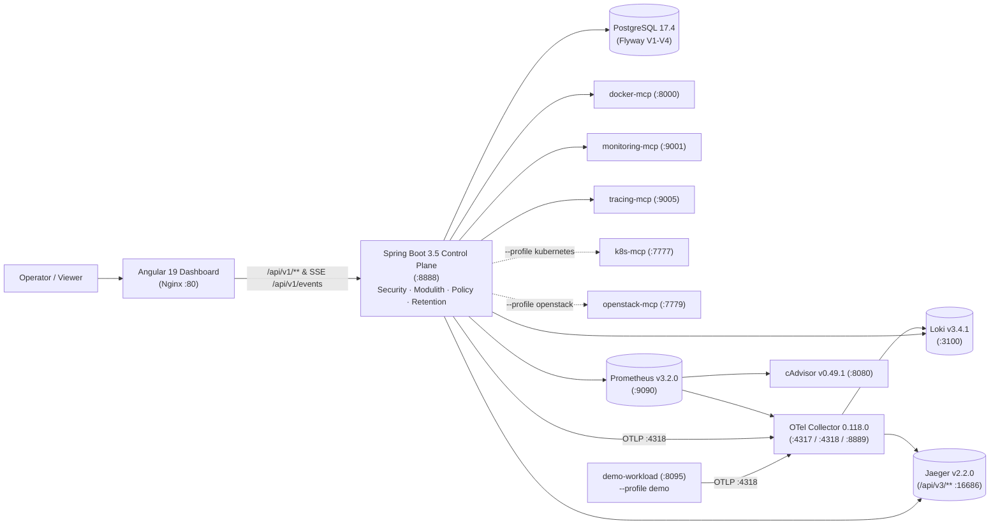

# HealOps — Incident Autopilot Platform

> **Evidence-driven incident investigation, human-in-the-loop remediation, and closed-loop verification** built with a Spring Boot 3.5 + Spring Modulith control plane, Angular 19 operational dashboard, PostgreSQL/Flyway system of record, OpenTelemetry observability stack, and bounded FastAPI infrastructure adapters.

HealOps turns noisy infrastructure alerts into an auditable, deterministic workflow: every alert is deduplicated, enriched with bounded/redacted runtime evidence, diagnosed with explicit evidence citations (`evidence_items` UUIDs), gated behind policy-checked operator approvals (`Idempotency-Key` + `@Version` optimistic locking), executed via non-shell allowlisted tool runners, and verified with `BEFORE` / `AFTER` / `POST_ROLLBACK` health snapshots.

> **Scope Notice:** HealOps is built for **local engineering labs, controlled staging sandboxes, and technical demonstrations**. Before any production rollout, replace the local in-memory authentication provider with enterprise OIDC/SSO, restrict adapter network ingress to the internal bridge, and validate cluster remediation against dedicated staging clusters.

---

## Tech Stack Overview

| Layer | Technologies & Pinned Versions |
| --- | --- |
| **Control Plane & Orchestration** | Java `21`, Spring Boot `3.5.6`, Spring Modulith `1.4.1` (JPA durable events & startup recovery), Spring Security `6.5` (`@EnableMethodSecurity`, CSRF cookies), Spring AI `1.0.3` (optional Gemini), Springdoc OpenAPI `2.8.8` |
| **Operational Dashboard** | Angular `19.2`, RxJS `7.8`, TypeScript `5.7`, Bootstrap `5.3.8` (selective SCSS), Bootstrap Icons `1.13.1`, Chart.js `4.4.8` (tree-shakeable), Cytoscape `3.30.4`, Marked `16.4.0`, Nginx reverse proxy + SSE gateway |
| **Persistence & Schema** | PostgreSQL `17.4-alpine`, Flyway (`V1`–`V4` migrations, `ddl-auto=validate`, `clean-disabled=true`), H2 (isolated test profile) |
| **Observability Stack** | OpenTelemetry Collector `0.118.0` (OTLP gRPC `:4317`, HTTP `:4318`, Prom `:8889`), Jaeger `2.2.0` (`/api/v3/**`), Grafana Loki `3.4.1`, Prometheus `3.2.0`, cAdvisor `v0.49.1` |
| **Infrastructure Adapters** | Python `3.11`/`3.13`, FastAPI `0.115.12`, Uvicorn `0.34.0`, Docker SDK `7.1.0`, Kubernetes Python Client `34.1.0` |
| **Verification & CI** | JUnit 5, `@WebMvcTest`, PostgreSQL Testcontainers, Karma + ChromeHeadless, `pytest`, static anti-pattern verifier, GitHub Actions |

---

## Architecture



### Core Capabilities

1. **Durable Incident Lifecycle & Event-Driven Orchestration**
   - Alert intake (`POST /api/v1/incidents` and `POST /api/v1/incidents/webhooks/alertmanager`) with idempotent deduplication (`source + environmentId + fingerprint`) and optimistic locking (`@Version`).
   - Guarded state machine (`ALERTED` → `GATHERING_EVIDENCE` → `CORRELATING_SIGNALS` → `DIAGNOSING` → `AWAITING_APPROVAL` → `EXECUTING` → `VERIFYING` → `CLOSED` / `ROLLING_BACK` → `ROLLED_BACK` / `FAILED` / `CANCELLED`) orchestrated asynchronously via Spring Modulith 1.4 JPA event publications with startup recovery.
2. **Evidence Collection, Citation-Checked Diagnosis & Allowlisted Remediation**
   - Bounded, timeout-protected, secret-redacted evidence collectors; partial adapter failures persist typed `COLLECTION_ERROR` items without discarding healthy evidence.
   - Deterministic rule engine (`deterministic-rules-v1.0.0`) with optional Spring AI structured LLM synthesis; hallucinated `evidence_items` UUIDs or non-allowlisted actions are rejected.
   - OPA-ready `PolicyEvaluator` (`policy-v1.0.0`), approval queue with `Idempotency-Key` and `409 Conflict` version protection, non-shell allowlisted `ActionExecutor`s, `BEFORE` / `AFTER` / `POST_ROLLBACK` health snapshots, automatic rollback on failed verification for reversible actions, and append-only `audit_records`.
3. **Real-Time Operational Dashboard & Observability BFF**
   - Angular 19 `OnPush` standalone lazy routes (`/dashboard`, `/incidents`, `/incidents/:incidentId`, `/approvals`, `/services`, `/chat`, `/runbooks`).
   - Single shared SSE connection per selected environment (`GET /api/v1/events?environmentId=...`) with `Last-Event-ID` gapless replay and Nginx streaming proxy.
   - Bounded BFF endpoints for allowlisted range metrics (`/api/v1/metrics/range`), sanitized logs (`/api/v1/logs`), Jaeger v3 OTLP traces (`/api/v1/traces`), derived service topology (`/api/v1/topology`), persistent conversations (`/api/v1/conversations`), Markdown/JSON final incident reports (`/api/v1/incidents/{id}/report`), draft/publish runbooks (`/api/v1/runbooks`), and remediation analytics (`/api/v1/analytics/remediation`).
4. **Configurable Retention & Immutability Guardrails**
   - Scheduled cleanup (`healops.retention.*`) purges expired `dashboard_events`, expired `conversation_sessions` / `conversation_messages`, and stale uncited raw telemetry rows while **never deleting** immutable `audit_records`, `incidents`, `incident_events`, `approval_decisions`, `incident_reports`, or `remediation_outcomes`.

---

## What's Live vs. Simulated

HealOps separates live local infrastructure from optional cluster profiles and controlled sandbox simulations:

| Component / Capability | Mode | How It Works |
| --- | --- | --- |
| **Control Plane, PostgreSQL 17.4, Flyway, SSE & Angular 19 UI** | **Live** | Full durable workflow, RBAC + CSRF enforcement, `Idempotency-Key` approvals, `audit_records`, and `Last-Event-ID` replay run against real PostgreSQL. |
| **OTel Collector, Jaeger v2/v3, Loki v3, Prometheus v3 & cAdvisor** | **Live** | Real OTLP ingestion (`:4317`/`:4318`), Jaeger `/api/v3/**` trace queries, Loki log queries, and Prometheus PromQL queries. |
| **`demo-workload` (`--profile demo`) & `docker-mcp`** | **Live** | `healops-demo-workload` emits real HTTP 5xx faults, OTLP traces/logs/metrics, and recovers via a live Docker container restart (`RESTART_CONTAINER`). |
| **`monitoring-mcp` & `tracing-mcp`** | **Live** | Query real Prometheus and Jaeger v3 endpoints inside the Compose network. |
| **Gemini LLM Diagnosis & Copilot Chat** | **Optional Live / Fallback** | Calls Gemini OpenAI-compatible API when `GEMINI_API_KEY` is configured; falls back cleanly to deterministic rule-based diagnosis and evidence summaries when offline or using placeholder keys. |
| **`k8s-mcp` (`--profile kubernetes`)** | **Optional Profile (External Cluster)** | Real Kubernetes client (`kubernetes==34.1.0`) with protected namespace guards (`kube-system`, `kube-public`, `kube-node-lease`); requires mounting a cluster kubeconfig via `KUBECONFIG_PATH`. |
| **`openstack-mcp` (`--profile openstack`)** | **Optional Profile (Simulated Inventory / Live SSH)** | Reads local JSONL logs and Prometheus metrics; `list_services()`/`list_nodes()` return simulated defaults when no live OpenStack nodes are attached, while `/action/restart` runs validated non-shell `ssh ... systemctl restart` against configured nodes. |
| **`demo-*` Kubernetes Rollback Sandbox (`SPRING_PROFILES_ACTIVE=demo`)** | **Controlled Simulation** | In-process replica/revision state in `DefaultRemediationAdapterClient` scoped strictly to `demo-*` namespaces under the `demo` Spring profile so reviewers can exercise `SCALE_K8S_DEPLOYMENT` → verification failure → `ROLLING_BACK` → `ROLLED_BACK` without a cluster. |
| **`test` Spring Profile** | **Controlled Simulation** | `healops.remediation.live-adapter-enabled=false` and `healops.observability.live-query-enabled=false` keep unit, `@WebMvcTest`, and E2E integration suites fast and offline-safe. |

---

## Screenshots & Demo Walkthrough

To showcase the UI on GitHub, capture screenshots or short GIFs of the running `--profile demo` stack and drop them into `docs/images/` using the paths below:

| View | Target Asset Path | What It Demonstrates |
| --- | --- | --- |
| **1. Command Center** (`/dashboard`) | `docs/images/command-center.png` | Active/severity KPI cards, service health cards, remediation MTTR analytics, live SSE feed, and RBAC-gated demo alert trigger. |
| **2. Incident Detail & Evidence Drawer** (`/incidents/:id`) | `docs/images/incident-detail-evidence.png` | Ordered phase timeline, evidence-cited diagnosis hypotheses opening the `<dialog>` evidence inspector, `BEFORE`/`AFTER` health comparison, and Markdown/JSON final report. |
| **3. Approval Queue & Confirmation Dialog** (`/approvals`) | `docs/images/approval-dialog.png` | Pending allowlisted action with risk level, command preview, rollback strategy, `Idempotency-Key` submission lock, and optimistic `expectedVersion` conflict handling. |
| **4. Services & Cytoscape Topology** (`/services`) | `docs/images/service-topology.png` | Lazy-loaded Cytoscape dependency graph, Chart.js allowlisted range metrics, Jaeger v3 critical path/slowest spans, and sanitized Loki logs. |
| **5. Automatic Rollback Flow** (`/incidents/:id`) | `docs/images/auto-rollback.png` | Reversible `SCALE_K8S_DEPLOYMENT` in `demo-sandbox` failing `AFTER` verification and transitioning `ROLLING_BACK` → `ROLLED_BACK` with `POST_ROLLBACK` snapshot. |

> **Tip for adding screenshots:** Start the `demo` stack (`SPRING_PROFILES_ACTIVE=demo docker compose --profile demo up -d --build`), run `python scripts/run_acceptance.py` to populate both a recovered `CLOSED` incident and a `ROLLED_BACK` incident, then sign in at `http://localhost` as `operator` / `operator-local-dev` and save captures under `docs/images/`.

---

## Prerequisites

- **Docker Engine / Docker Desktop** with **Docker Compose v2**
- **Java 21** (for local Maven verification)
- **Node.js 20/22** and **Chrome/Chromium** (for local Angular builds and Karma tests)
- **Python 3.11+** with `pytest` and `requests` (for adapter tests and the live acceptance script)
- Optional: `GEMINI_API_KEY` for LLM-assisted diagnosis and Copilot chat

---

## Quick Start

### 1. Create your local `.env`

**macOS / Linux (bash/zsh):**
```bash
cp .env.example .env
```

**Windows (PowerShell):**
```powershell
Copy-Item .env.example .env
```

Edit `.env` and set a strong `POSTGRES_PASSWORD` (and optionally `GEMINI_API_KEY`). **Never commit `.env`.**

### 2. Start the recommended `demo` stack

The `demo` profile starts the isolated, non-root `demo-workload` container (`healops-demo-workload` on `:8095`) alongside the full observability and control-plane stack. Combining it with `SPRING_PROFILES_ACTIVE=demo` seeds the `demo` environment and a published demo runbook.

**macOS / Linux (bash/zsh):**
```bash
export SPRING_PROFILES_ACTIVE=demo
# Optional if host port 8080 is in use: export CADVISOR_PORT=8081
docker compose --profile demo up -d --build
```

**Windows (PowerShell):**
```powershell
$env:SPRING_PROFILES_ACTIVE = "demo"
# Optional if host port 8080 is in use: $env:CADVISOR_PORT = "8081"
docker compose --profile demo up -d --build
```

Open the HealOps dashboard at [http://localhost](http://localhost).

Verify service health and run the automated end-to-end live acceptance suite:

```bash
docker compose --profile demo ps -a
python scripts/run_acceptance.py
```

### 3. Optional cluster adapter profiles (`kubernetes` / `openstack`)

Only enable `--profile kubernetes` if you have a container-reachable kubeconfig (defaults to `./.kube/config-healops`, override via `KUBECONFIG_PATH`):

```bash
KUBECONFIG_PATH="$HOME/.kube/config-healops" docker compose --profile kubernetes up -d --build
```

Enable `--profile openstack` to start the optional `openstack-mcp` adapter on port `7779`:

```bash
docker compose --profile openstack up -d --build
```

---

## Local Credentials & Roles

Default local accounts are configured in `SecurityConfiguration` and customizable via `.env`:

| Username | Default Password | Role | Authorities |
| --- | --- | --- | --- |
| `operator` | `operator-local-dev` | `ROLE_OPERATOR` | `incident:read`, `incident:write`, `incident:approve`, `incident:execute`, `runbook:publish`, `env:local`, `env:staging` (plus `env:demo` when `SPRING_PROFILES_ACTIVE=demo`) |
| `viewer` | `viewer-local-dev` | `ROLE_VIEWER` | `incident:read`, `env:local`, `env:staging` (plus `env:demo` when `SPRING_PROFILES_ACTIVE=demo`) |

- Browser mutations use Angular-compatible CSRF cookies (`XSRF-TOKEN` / `X-XSRF-TOKEN`).
- Alertmanager webhooks (`/api/v1/incidents/webhooks/alertmanager`) require `incident:write` and are CSRF-exempt.
- `viewer` users cannot create incidents, approve actions (`403 Forbidden`), or publish runbooks.
- Environment selection in the UI never grants authorization; every BFF, approval, and SSE endpoint enforces `env:<environmentId>` server-side.

---

## End-to-End Demo Incident, Approval & Rollback Walkthrough

With `--profile demo` and `SPRING_PROFILES_ACTIVE=demo` running:

1. **Inject synthetic latency, errors, and unhealthy status into `demo-workload`:**
   ```bash
   curl -X POST "http://localhost:8095/faults/latency?ms=800"
   curl -X POST "http://localhost:8095/faults/error-rate?rate=1.0"
   curl -X POST "http://localhost:8095/faults/unhealthy?enabled=true"
   curl -s "http://localhost:8095/work" || true
   ```
2. **Trigger an alert (via `/dashboard` "Simulate Alert" or `POST /api/v1/incidents/webhooks/alertmanager`):**
   - Select **Demo Sandbox (`demo`)** in the top navigation bar.
   - Watch the deduplicated incident stream in real time via SSE, gather bounded evidence, capture a `BEFORE` snapshot, generate an evidence-cited diagnosis, and queue an allowlisted action (`AWAITING_APPROVAL`).
3. **Approve or reject in `/approvals`:**
   - Sign in as `operator`, review risk level, command preview, and rollback strategy, then submit approval with an audit reason.
   - Reusing an `Idempotency-Key` returns the existing decision without re-executing; stale versions return `409 Conflict`.
4. **Observe execution, verification, automatic rollback, and reporting:**
   - Track live execution progress on `/incidents/:incidentId`.
   - When `AFTER` health recovers, the incident closes (`CLOSED`), generates a structured JSON + rendered Markdown report, and supports drafting a versioned runbook in `/runbooks`.
   - When verification fails on a reversible action (`SCALE_K8S_DEPLOYMENT` in `demo-sandbox`), the workflow automatically transitions `ROLLING_BACK` → `ROLLED_BACK`, captures a `POST_ROLLBACK` snapshot, and records the rollback audit trail.
5. **Reset demo faults when finished:**
   ```bash
   curl -X POST "http://localhost:8095/faults/reset"
   ```

---

## Service & Observability URLs

| Component | URL | Notes |
| --- | --- | --- |
| **HealOps Dashboard (Angular 19 + Nginx)** | [http://localhost](http://localhost) | Proxies `/api/**` and SSE `/api/v1/events` |
| **Spring Boot Control Plane API / Health** | [http://localhost:8888/actuator/health](http://localhost:8888/actuator/health) | OpenAPI `/v3/api-docs` & Swagger UI `/swagger-ui.html` (authenticated) |
| **Jaeger v2 UI & v3 API** | [http://localhost:16686](http://localhost:16686) | OTLP v3 query API at `/api/v3/**` |
| **Prometheus v3** | [http://localhost:9090](http://localhost:9090) | Scrapes `cadvisor:8080` and `otel-collector:8889` |
| **Loki v3** | [http://localhost:3100/ready](http://localhost:3100/ready) | Receives OTLP logs from Collector |
| **OpenTelemetry Collector Health / Metrics** | [http://localhost:13133](http://localhost:13133) | OTLP gRPC `:4317`, HTTP `:4318`, Prom `:8889` |
| **Controlled Demo Workload (`demo` profile)** | [http://localhost:8095/health](http://localhost:8095/health) | Metrics at `/metrics`, fault endpoints at `/faults/*` |
| **Docker MCP Adapter** | [http://localhost:8000/docs](http://localhost:8000/docs) | Internal adapter; do not expose publicly |
| **Monitoring MCP Adapter** | [http://localhost:9001/docs](http://localhost:9001/docs) | Prometheus metrics & forecasting |
| **Tracing MCP Adapter** | [http://localhost:9005/docs](http://localhost:9005/docs) | Jaeger v3 OTLP trace analysis |
| **Kubernetes MCP Adapter (`kubernetes` profile)** | [http://localhost:7777/docs](http://localhost:7777/docs) | Protected namespace guards enforced |
| **OpenStack MCP Adapter (`openstack` profile)** | [http://localhost:7779/docs](http://localhost:7779/docs) | Log ingestion, analysis, validated non-shell restart |

---

## PostgreSQL Persistence, Retention & Backup

- **Schema ownership:** Flyway manages all DDL (`V1`–`V4` under `Openstack-ai-agent/src/main/resources/db/migration/postgresql/`) with `spring.jpa.hibernate.ddl-auto=validate`, `validate-on-migrate=true`, and `clean-disabled=true`.
- **Retention defaults (`application.properties`):**
  - `healops.retention.enabled=true` (hourly cron `0 0 * * * *`)
  - `healops.retention.dashboard-event-ttl=P7D`
  - `healops.retention.telemetry-reference-ttl=P30D` (uncited, unreferenced raw telemetry only)
  - `healops.retention.conversation-ttl=P30D`
  - Immutable `audit_records`, `incidents`, `incident_events`, `approval_decisions`, `incident_reports`, and `remediation_outcomes` are never purged.
- **Logical backup (`pg_dump`) & restore:**
  ```bash
  # Backup
  docker compose exec -T postgres pg_dump -U healops -d healops -Fc > healops-backup.dump

  # Restore into a running postgres container
  docker compose exec -T postgres pg_restore -U healops -d healops --clean --if-exists < healops-backup.dump
  ```

---

## Automated Tests & Verification Commands

All test suites run without live Docker sockets, kubeconfig, OpenStack, Gemini, or Gmail credentials (PostgreSQL Testcontainers specs run automatically when Docker is available and skip cleanly otherwise):

```bash
# 1. Static security, anti-pattern & OTel Collector config validation
python scripts/verify_security_antipatterns.py

# 2. Spring Boot unit, @WebMvcTest, Testcontainers PostgreSQL, retention & E2E workflow tests
cd Openstack-ai-agent && ./mvnw test   # Windows: .\mvnw.cmd test

# 3. Python FastAPI adapter & demo-workload test suites
pytest mcp_docker_server/tests mcp_k8s_server/tests mcp_openstack_server/tests \
  mcp-server-promethus/tests tracing_mcp/tests demo-workload/tests

# 4. Angular 19 unit tests & production bundle build
cd agentUI && npm test -- --watch=false --browsers=ChromeHeadless && npm run build

# 5. Docker Compose schema validation
docker compose --env-file .env.example config --quiet
docker compose --profile demo --env-file .env.example config --quiet

# 6. OpenTelemetry Collector config validation (requires Docker)
docker run --rm -v "$(pwd)/observability/otel-collector.yaml:/etc/otelcol-contrib/config.yaml:ro" \
  otel/opentelemetry-collector-contrib:0.118.0 validate --config=/etc/otelcol-contrib/config.yaml

# 7. Repeatable live end-to-end acceptance suite against running `--profile demo` stack
python scripts/run_acceptance.py
```

CI automation mirrors these stages in [`.github/workflows/ci.yml`](.github/workflows/ci.yml).

---

## Explicit Non-Production Limitations & Operational Prerequisites

Before deploying HealOps outside local development or controlled sandboxes, complete these prerequisites:

- **Authentication & Identity:** Ships with local `InMemoryUserDetailsManager` HTTP Basic + CSRF cookies for local/demo use. Production deployments must integrate enterprise OIDC/OAuth2/SSO, MFA, and externalized secret management.
- **Adapter Network Isolation:** Python adapters are designed strictly for the internal Compose/cluster bridge network (`docker-mcp` mounts `/var/run/docker.sock` and `cadvisor` runs privileged locally). Remove host port bindings for internal adapters and restrict ingress strictly to the Nginx/Spring control-plane gateway.
- **Cluster Remediation Validation:** `openstack-mcp` executes a validated non-shell `ssh` argument list (`systemctl restart`) against configured compute nodes, and `k8s-mcp` requires a scoped cluster kubeconfig (`--profile kubernetes`). Validate both adapters against dedicated staging clusters before production use.
- **Persistence, Backup & Retention SLAs:** Configure automated `pg_dump` / WAL archiving for PostgreSQL, verify restore drills, and align `healops.retention.*` TTLs with organizational audit policies.
- **Autonomous Production Remediation:** Human approval (`remediationApprovalRequired=true`) is enforced across environments; do not disable approval gates for production workloads.

---

## Shutdown

```bash
docker compose --profile demo --profile kubernetes --profile openstack down
```

Append `-v` only if you want to permanently destroy the `postgres_data` volume.
