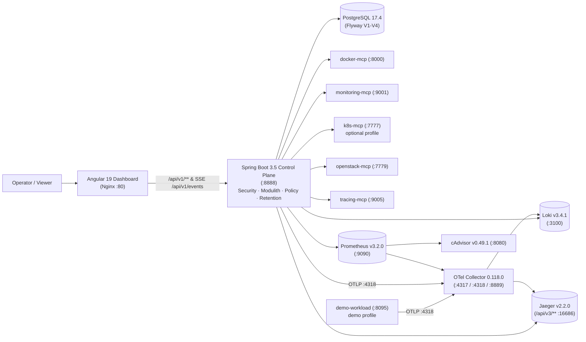

# HealOps — Incident Autopilot Platform

HealOps is an evidence-driven incident-response and remediation platform built around a single Spring Boot 3.5 control plane, an Angular 19 operational dashboard, a PostgreSQL/Flyway system of record, OpenTelemetry observability (Collector, Jaeger v2, Loki v3, Prometheus v3), and five bounded Python FastAPI MCP adapters for Docker, Prometheus, Kubernetes, OpenStack, and distributed tracing.

> **Important Scope Notice:** HealOps is designed for **local development, controlled staging sandboxes, and demonstration environments**. Do **not** enable autonomous production remediation without replacing the local in-memory authentication provider with enterprise SSO/OIDC, enforcing network-level adapter isolation, reviewing retention/backup SLAs, and auditing operational policy rules.

---

## Architecture



### Core Capabilities

1. **Durable Incident Lifecycle & Event-Driven Orchestration**
   - Alert intake (`POST /api/v1/incidents` and `POST /api/v1/incidents/webhooks/alertmanager`) with idempotent deduplication (`source + environmentId + fingerprint`) and optimistic locking (`@Version`).
   - Guarded state machine (`ALERTED` → `GATHERING_EVIDENCE` → `CORRELATING_SIGNALS` → `DIAGNOSING` → `AWAITING_APPROVAL` → `EXECUTING` → `VERIFYING` → `CLOSED` / `ROLLING_BACK` → `ROLLED_BACK` / `FAILED` / `CANCELLED`) orchestrated asynchronously via Spring Modulith 1.4 JPA durable event publications with startup recovery.
2. **Evidence Collection, Diagnosis & Allowlisted Remediation**
   - Bounded, timeout-protected, secret-redacted evidence collectors; partial adapter failures persist typed `COLLECTION_ERROR` items without discarding healthy evidence.
   - Deterministic rule engine (`deterministic-rules-v1.0.0`) with optional Spring AI structured LLM synthesis; hallucinated evidence UUIDs or non-allowlisted actions are rejected.
   - OPA-ready `PolicyEvaluator` (`policy-v1.0.0`), approval queue with `Idempotency-Key` and optimistic version conflict protection (`409 Conflict`), non-shell allowlisted `ActionExecutor`s, `BEFORE`/`AFTER`/`POST_ROLLBACK` health snapshots, automatic rollback on failed verification for reversible actions, and append-only `audit_records`.
3. **Real-Time Operational Dashboard & Observability BFF**
   - Angular 19 standalone lazy routes (`/dashboard`, `/incidents`, `/incidents/:incidentId`, `/approvals`, `/services`, `/chat`, `/runbooks`).
   - Single shared SSE connection per selected environment (`GET /api/v1/events?environmentId=...`) with `Last-Event-ID` gapless replay and Nginx streaming proxy.
   - Bounded BFF endpoints for allowlisted range metrics (`/api/v1/metrics/range`), sanitized logs (`/api/v1/logs`), Jaeger v3 OTLP traces (`/api/v1/traces`), derived service topology (`/api/v1/topology`), persistent conversations (`/api/v1/conversations`), Markdown/JSON final incident reports (`/api/v1/incidents/{id}/report`), draft/publish runbooks (`/api/v1/runbooks`), and remediation analytics (`/api/v1/analytics/remediation`).
4. **Configurable Retention & Immutability Guardrails**
   - Scheduled cleanup (`healops.retention.*`) purges expired `dashboard_events`, expired `conversation_sessions`/`conversation_messages`, and stale uncited/unreferenced raw telemetry rows while **never deleting** immutable `audit_records`, `incidents`, `incident_events`, `approval_decisions`, `incident_reports`, or `remediation_outcomes`.

---

## Prerequisites

- **Docker Desktop** (or Docker Engine with Docker Compose v2)
- **Java 21** (for local Maven test runs)
- **Node.js 20/22** and **Chrome/Chromium** (for local Angular builds and Karma tests)
- **Python 3.11+** with `pytest` (for local adapter test runs)
- Optional: Gemini API key (`GEMINI_API_KEY`) for LLM-assisted diagnosis and chat; Gmail app password if email notifications are needed.

---

## Quick Start

### 1. Create your local `.env` file

```powershell
Copy-Item .env.example .env
```

Edit `.env` and set a strong `POSTGRES_PASSWORD` (and optionally `GEMINI_API_KEY`). **Never commit `.env`.**

### 2. Start the default stack

```powershell
docker compose up -d --build
```

Open the HealOps dashboard at [http://localhost](http://localhost).

### 3. Start the safe `demo` profile (recommended for walkthroughs)

The `demo` profile starts an isolated, non-root `demo-workload` container (`healops-demo-workload` on port `8095`) that emits synthetic latency, HTTP 5xx errors, unhealthy status, structured logs, and OTLP traces without touching host resources. Combine it with `SPRING_PROFILES_ACTIVE=demo` to seed the `demo` environment and a published demo runbook:

```powershell
$env:SPRING_PROFILES_ACTIVE = "demo"
docker compose --profile demo up -d --build
```

Verify running services:

```powershell
docker compose --profile demo ps -a
```

### 4. Optional Kubernetes profile

Only enable `--profile kubernetes` if you have a container-reachable kubeconfig at `%USERPROFILE%\.kube\config-healops` (never required for default, `demo`, or CI runs):

```powershell
docker compose --profile kubernetes up -d --build
```

---

## Local Credentials & Roles

Default local accounts are configured in `SecurityConfiguration` and customizable via `.env`:

| Username | Default Password | Role | Authorities |
| --- | --- | --- | --- |
| `operator` | `operator-local-dev` | `ROLE_OPERATOR` | `incident:read`, `incident:write`, `incident:approve`, `incident:execute`, `runbook:publish`, `env:local`, `env:staging` (plus `env:demo` when `SPRING_PROFILES_ACTIVE=demo`) |
| `viewer` | `viewer-local-dev` | `ROLE_VIEWER` | `incident:read`, `env:local`, `env:staging` (plus `env:demo` when `SPRING_PROFILES_ACTIVE=demo`) |

- Browser mutations use Angular-compatible CSRF cookies (`XSRF-TOKEN` / `X-XSRF-TOKEN`).
- Alertmanager webhooks (`/api/v1/incidents/webhooks/alertmanager`) require `incident:write` and are CSRF-exempt.
- `viewer` users cannot create incidents, approve actions (`403 Forbidden`), or publish runbooks.
- Environment selection in the UI never grants authorization; every BFF, approval, and SSE endpoint enforces `env:<environmentId>` server-side.

---

## End-to-End Demo Incident, Approval & Rollback Workflow

With `--profile demo` and `SPRING_PROFILES_ACTIVE=demo` running:

1. **Inject synthetic latency and errors into the isolated `demo-workload` container:**
   ```powershell
   Invoke-RestMethod -Method Post "http://localhost:8095/faults/latency?ms=800"
   Invoke-RestMethod -Method Post "http://localhost:8095/faults/error-rate?rate=1.0"
   Invoke-RestMethod -Method Post "http://localhost:8095/faults/unhealthy?enabled=true"
   # Generate a few failing requests + OTLP traces
   try { Invoke-RestMethod "http://localhost:8095/work" } catch {}
   ```
2. **Trigger an alert (via Dashboard `/dashboard` "Simulate Alert" or `POST /api/v1/incidents/webhooks/alertmanager`):**
   - Select the **Demo Sandbox (`demo`)** environment in the top bar.
   - Observe the deduplicated incident appear in real time via SSE, collect bounded evidence, capture a `BEFORE` health snapshot, produce an evidence-cited diagnosis, and queue an allowlisted remediation action (`AWAITING_APPROVAL`).
3. **Approve or reject in `/approvals`:**
   - Sign in as `operator`, inspect risk level, command preview, and rollback strategy, then confirm approval.
   - Duplicate submissions with the same `Idempotency-Key` return the existing decision without re-executing; stale versions return `409 Conflict`.
4. **Observe execution, verification, rollback, and final report:**
   - Watch live tool progress in `/incidents/:incidentId`.
   - When `AFTER` health recovers, the incident transitions to `CLOSED` and automatically generates a structured JSON + Markdown final report (and supports drafting a versioned runbook in `/runbooks`).
   - When verification fails on a reversible action (such as `SCALE_K8S_DEPLOYMENT`), the workflow automatically transitions through `ROLLING_BACK` → `ROLLED_BACK`, captures a `POST_ROLLBACK` snapshot, and records the rollback outcome and audit trail.
5. **Reset demo faults when finished:**
   ```powershell
   Invoke-RestMethod -Method Post "http://localhost:8095/faults/reset"
   ```

---

## Service & Observability URLs

| Component | URL | Notes |
| --- | --- | --- |
| **HealOps Dashboard (Angular 19 + Nginx)** | [http://localhost](http://localhost) | Proxies `/api/**` and SSE `/api/v1/events` |
| **Spring Boot Control Plane API / Health** | [http://localhost:8888/actuator/health](http://localhost:8888/actuator/health) | Swagger UI at `/swagger-ui.html` (authenticated) |
| **Jaeger v2 UI & v3 API** | [http://localhost:16686](http://localhost:16686) | OTLP v3 query API at `/api/v3/**` |
| **Prometheus v3** | [http://localhost:9090](http://localhost:9090) | Scrapes cAdvisor (`:8080`) and OTel Collector (`:8889`) |
| **Loki v3** | [http://localhost:3100/ready](http://localhost:3100/ready) | Receives OTLP logs from Collector |
| **OpenTelemetry Collector Health / Metrics** | [http://localhost:13133](http://localhost:13133) | OTLP gRPC `:4317`, HTTP `:4318`, Prom `:8889` |
| **Controlled Demo Workload (`demo` profile)** | [http://localhost:8095/health](http://localhost:8095/health) | Metrics at `/metrics`, fault endpoints at `/faults/*` |
| **Docker MCP Adapter** | [http://localhost:8000/docs](http://localhost:8000/docs) | Internal adapter; do not expose publicly |
| **Monitoring MCP Adapter** | [http://localhost:9001/docs](http://localhost:9001/docs) | Prometheus metrics & forecasting |
| **OpenStack MCP Adapter** | [http://localhost:7779/docs](http://localhost:7779/docs) | Log ingestion, analysis, validated non-shell restart |
| **Tracing MCP Adapter** | [http://localhost:9005/docs](http://localhost:9005/docs) | Jaeger v3 OTLP trace analysis |
| **Kubernetes MCP Adapter (`kubernetes` profile)** | [http://localhost:7777/docs](http://localhost:7777/docs) | Protected namespace guards enforced |

---

## PostgreSQL Persistence, Retention & Backup

- **Schema ownership:** Flyway manages all DDL (`V1`–`V4` under `Openstack-ai-agent/src/main/resources/db/migration/postgresql/`) with `spring.jpa.hibernate.ddl-auto=validate`, `validate-on-migrate=true`, and `clean-disabled=true`.
- **Retention defaults (`application.properties`):**
  - `healops.retention.enabled=true` (hourly cron `0 0 * * * *`)
  - `healops.retention.dashboard-event-ttl=P7D`
  - `healops.retention.telemetry-reference-ttl=P30D` (uncited, unreferenced raw telemetry only)
  - `healops.retention.conversation-ttl=P30D`
  - Immutable `audit_records`, `incidents`, `incident_events`, `approval_decisions`, `incident_reports`, and `remediation_outcomes` are never purged by the retention job.
- **Logical backup (`pg_dump`) & restore:**
  ```powershell
  # Backup
  docker compose exec -T postgres pg_dump -U healops -d healops -Fc > healops-backup.dump

  # Restore into a running postgres container
  Get-Content -Encoding Byte healops-backup.dump | docker compose exec -T postgres pg_restore -U healops -d healops --clean --if-exists
  ```

---

## Automated Tests & Verification Commands

All suites run cleanly without live Docker sockets, kubeconfig, OpenStack, Gemini, or Gmail credentials (PostgreSQL Testcontainers specs run automatically whenever Docker is available and skip cleanly otherwise):

```powershell
# 1. Static security, anti-pattern & OTel Collector config validation
python scripts/verify_security_antipatterns.py

# 2. Spring Boot unit, @WebMvcTest, Testcontainers PostgreSQL, retention & E2E workflow tests
Set-Location Openstack-ai-agent; .\mvnw.cmd test

# 3. Python MCP adapter & demo-workload FastAPI TestClient suites
pytest mcp_docker_server/tests
pytest mcp_k8s_server/tests
pytest mcp_openstack_server/tests
pytest mcp-server-promethus/tests
pytest tracing_mcp/tests
pytest demo-workload/tests

# 4. Angular 19 unit tests & production bundle build
Set-Location agentUI
npm test -- --watch=false --browsers=ChromeHeadless
npm run build

# 5. Docker Compose schema validation (default + demo profile)
docker compose --env-file .env.example config --quiet
docker compose --profile demo --env-file .env.example config --quiet
```

CI automation mirrors all of these stages in [`.github/workflows/ci.yml`](.github/workflows/ci.yml).

---

## Explicit Non-Production Limitations

- **Authentication:** Ships with local `InMemoryUserDetailsManager` HTTP Basic + CSRF cookies for local/demo use. Production deployments must integrate OIDC/OAuth2/SSO and externalized secret management.
- **Adapter network trust:** Python adapters are intended strictly for the internal Compose bridge network; `docker-mcp` mounts `/var/run/docker.sock` and `cadvisor` runs privileged on local Docker Desktop. Do not publish adapter ports to untrusted networks.
- **OpenStack remediation:** `openstack-mcp` executes a validated non-shell `ssh` argument list (`systemctl restart`) against configured compute nodes and has not been validated against a live multi-node OpenStack cluster.
- **Autonomous production remediation:** Human approval (`remediationApprovalRequired=true`) is enforced across environments; do not disable approval gates for production workloads.

---

## Shutdown

```powershell
docker compose --profile demo --profile kubernetes down
```

Append `-v` only if you want to permanently destroy the `postgres_data` volume.
